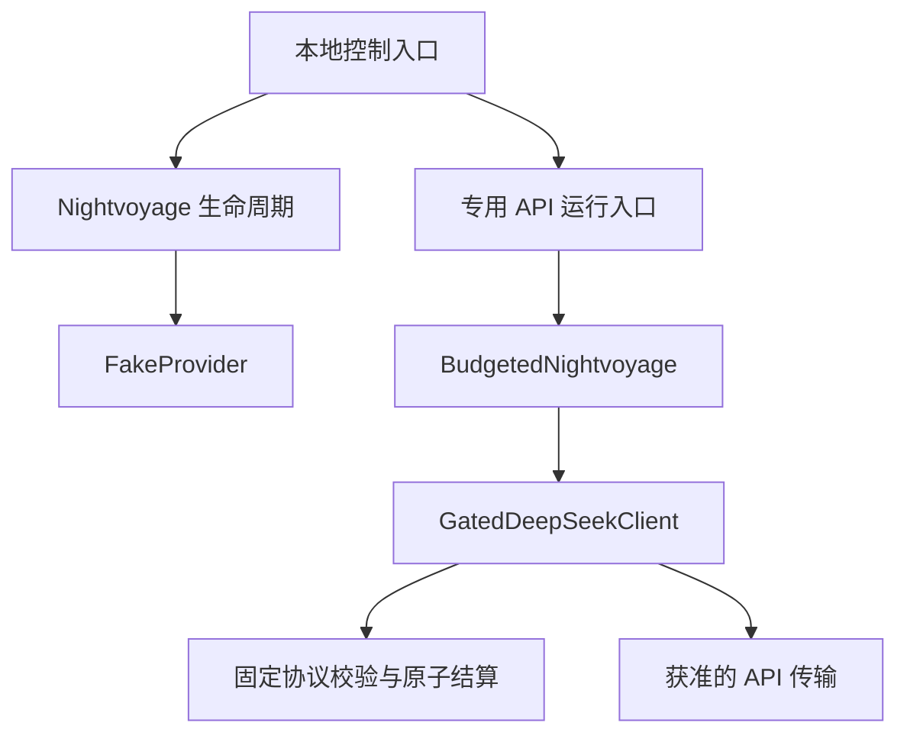

# 模型端口施工盘点 · 2026-10-18

## 固定基线

只读盘点基于 main `0bd58cdbcfe43cb38bc3afc558781a3a4df9a24f`。远端 main 已重新 fetch；原 checkout 有已暂存的历史工作，未覆盖或提交那些内容。新切片使用从该 main 建立的独立 worktree。仓库及上层检查未发现 AGENTS.md。项目为 MIT；本轮只使用项目自有代码与公开协议，无第三方实现复制或新增依赖。

重新读取 README、最近六次 main 提交、相关源码/测试、已保存运行回执及模型接入说明，重点检查 engine、Store、contract、FakeProvider、BudgetedNightvoyage、GatedDeepSeekClient、账本、inline 协议、现有本地控制端口，以及 GPT 请求/流解析和登录模块。全部自动测试重新运行：Linux、Node v24.19.0，`node --test` **879/879**，失败/取消/跳过/todo 均0，30330.409849 ms。不是 Windows 复测或真实模型运行。

## 已有的真实调用链

- `src/engine.js` 保存请求/会话去重、阶段状态、执行 owner、调用尝试、取消与恢复，发布分型梦簿；基本构造器只接受 FakeProvider 及其子类。
- `src/budgeted-runtime.js` 复用上述生命周期，替换 scene/wake 分发。客户端在同一次账本 settlement 中发布阶段检查点，不能把它拆成“先返回正文、稍后记账”。
- `src/gated-deepseek-client.js` 负责固定请求、权限、预算、传输、超时、响应边界、协议校验、保守 unknown 占款及一次发布回调。专用付费入口另有源码/候选/许可门禁。
- `scripts/local-dream-ports.mjs` 是输入/控制/读取 facade，固定假模型；它不是模型生成端口。
- GPT 的 `scripts/chatgpt-plan-protocol.mjs` 只有请求准备和有界 SSE 解析；`chatgpt-plan-login.mjs` 只有登录、签名/scope/目录核对与撤销尝试。二者尚未接到持久分幕执行器。

## 能力分类（盘点时）

| 状态 | 项目 | 证据与限制 |
| --- | --- | --- |
| 已有 | 两幕加醒来、持久化、去重、取消、检查点与来源撤回 | 源码及879项回归；单机受管理 Store，不保证外部备份和已交付副本擦除 |
| 已有 | API 专用入口与原子账本 | 独立模拟测试；另有用户历史单样本实机回报，不授予新调用 |
| 部分 | GPT 订阅 | 离线协议和本机登录模块；用户曾报告登录失败，不能认定账户或真实推理可用 |
| 缺失 | 中立 DreamModelPort、统一选择/回执 | 当前由 fake/provider 子类和专用运行类分别处理 |
| 缺失 | Codex 梦境 adapter 执行器 | 没有 app-server 梦境接入，也没有工具禁用的运行证明 |
| 不能确认 | GPT/Codex 真实型号资格、当前用量设置、远端取消 | 目录不是推理资格证明；本轮不得登录或调用来探测 |
| 待对接 | Asteria 两座桥与 canonical state | 不在夜航实现，不声称兼容或已连通 |

## 实施判断与切片

当前边界足以继续离线施工，不存在必须扩大授权才能定义合同的冲突。新增模型端口与复用生命周期的执行器先放在 scripts 下，避免改变旧付费源码清单或追认旧批准；不把新合同套到旧用户梦簿，不更新历史占款。

1. 冻结阶段请求、规范化响应、固定诊断、选择身份和回执。
2. Fake adapter 跑完整闭环，验证固定入口、preflight 显式选择、模糊尝试阻断、检查点恢复、预算、取消、晚到与撤回。
3. API compatibility adapter 保留现有客户端/账本/原子发布，先用 stub 跑基础和 inline 协议；历史正式入口保持原样，不能直接接管旧 run。
4. 分别保留 ChatGPTPlanAdapter 与 CodexAdapter。当前无真实执行资格，两者失败关闭；不把占位类称为真实订阅执行器。
5. 完整回归、diff/敏感信息检查后提交；真实账户/推理前单独暂停。后续以 adapter 内部实现接入，不重写梦境生命周期，也不实现 Asteria 的桥。

详细合同、当前完成程度和余下门槛见 [DREAM-MODEL-PORT.md](DREAM-MODEL-PORT.md)。
